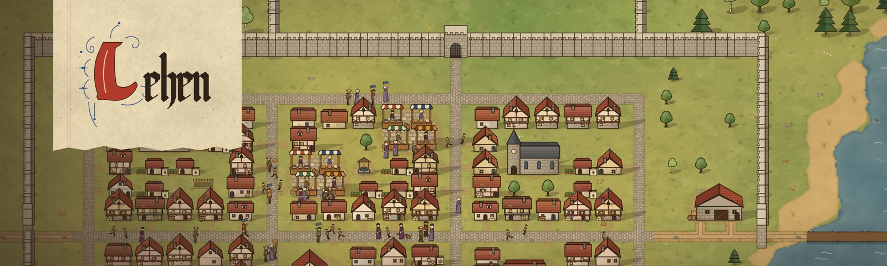

### Game design and strategy systems

Working on [**Lehen**](https://github.com/oliver0838/lehen-game), a medieval strategy game where town building, rule, diplomacy and war all happen in one connected world.

| | |
|---|---|
| **World** | Five kingdoms and around 400 provinces across three landmasses |
| **War** | Regiments, formations and morale, fought in real time |
| **Economy** | Road networks you lay out yourself, carts, markets, caravans and sea routes |
| **Look** | Every building, figure and map is drawn in code, with no image assets |
| **Sound** | Music and effects synthesized at runtime |

**Status:** in active development
